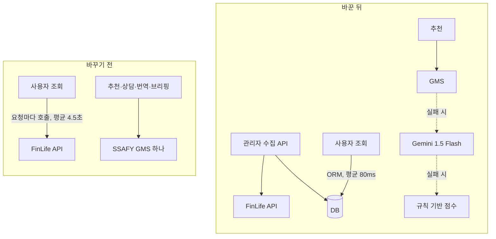
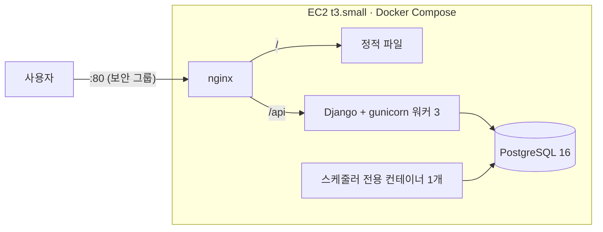

<h2 align="center">이윤우 · 풀스택 개발자</h2>

화면에서 서버, 배포까지 직접 만들고 만든 것이 제대로 동작하는지 끝까지 확인합니다.

<a href="mailto:leeyw001013@naver.com">leeyw001013@naver.com</a> ·
<a href="https://solved.ac/profile/leeyw1709">solved.ac leeyw1709</a> ·
SSAFY 15기

 

## 소개

생명과학을 전공하다 컴퓨터학부를 복수전공(51학점)했습니다. 규칙대로 계산한 결과를 화면에 보여 주는 일이 재미있어서 시작했고, 지금까지 프로젝트에서 화면(React)과 서버(Django), 배포(EC2)를 각각 직접 맡아 봤습니다. SSAFY 15기 1학기를 수료했고 2학기 과정에 있습니다.

자격: 정보처리기사, SQLD, ADsP, 컴퓨터활용능력 1급

### 숫자와 잰 방법

이 README의 숫자는 모두 어떻게 쟀는지 함께 적었습니다.

| 숫자 | 무엇 | 어떻게 쟀나 |
|---|---|---|
| **평균 4.5초 → 80ms** | FinFit 상품 조회 응답 | 바꾸기 전과 뒤를 같은 로컬 환경에서 브라우저 Network 탭과 Postman으로 각각 20번 잰 평균 |
| **0.40초** | 배포 뒤 `/api/products/` 응답 | 외부에서 curl로 측정. 네트워크 포함이라 위 값과 비교하지 않음 |
| **32.9초 → 19ms** | 2만 건 조인 (전공 과제) | 원본 중첩 루프를 되살려 같은 데이터(시드 0)로 다시 돌림. 크기마다 1회 측정 |
| **50가지 × 2회** | FinFit 추천 일관성 | 목돈·기간 조합마다 두 번 돌려 상품, 순위, 근거 문장 비교 |
| **0.46~0.56** | SSabway 기기별 화면 비율 차이 | 접속할 때 실제 비율을 재서 상대에게 보내도록 바꾼 뒤 다른 기기끼리 반복 확인 |

 

## 기술

| 구분 | 기술 | 어디서 썼나 |
|---|---|---|
| 주로 씀 | Python, Django, Django REST Framework, ORM, SimpleJWT | FinFit 백엔드 전체 |
| 주로 씀 | React 19, TypeScript, TanStack Query, Zustand, MSW | SOBI 화면 14개, SSabway 관리자 앱 |
| 직접 해 봄 | Docker Compose, nginx, gunicorn, PostgreSQL, AWS EC2, Linux | FinFit 배포 1회. 상시 운영 경험은 없음 |
| 직접 해 봄 | SQL, MySQL, JDBC, Git·GitLab MR, OpenVidu, Google OAuth | SQLD, DB 과목 과제, SSabway |
| 공부 중 | Java, Spring Boot, JPA | SSAFY 2학기 프로젝트(진행 중). 결과물은 아직 없음 |
| 팀 환경 | Jenkins, GitLab CI, Redis | 팀 인프라 담당이 구축. 직접 구축하지 않음 |

 

## 프로젝트

### FinFit · 금융성향 기반 금융상품 추천 서비스

[저장소](https://github.com/luster-woo/finance_pjt) · 2026.05 ~ 06 (약 6주) · 2인 · 팀장, 백엔드 전체 (프론트 Vue 3는 팀원 담당)

금융성향 검사 결과로 예·적금, 주식, 카드를 추천하고 AI 상담을 하는 서비스입니다. Django REST Framework로 앱 12개, 모델 26개, URL 72개를 만들고 외부 API 6종을 연동했습니다.

**느린 외부 API를 요청 경로에서 뗐습니다.** 상품 목록을 열 때마다 금융감독원 FinLife API를 불렀고 응답에 평균 4.5초가 걸렸습니다. 관리자만 부를 수 있는 수집 API로 상품을 DB에 저장하고, 사용자 요청은 DB만 읽게 나눴습니다. 같은 조건에서 잰 평균이 80ms가 됐고, 외부 API에 없던 검색·정렬·필터도 ORM으로 붙였습니다. 대신 상품 정보는 관리자가 다시 수집해야 갱신됩니다.

**추천만큼은 AI가 실패해도 결과가 나오게 했습니다.** 응답이 오지 않으면 GMS, Gemini, 규칙 기반 점수 순서로 넘어가고, AI가 JSON을 코드블록으로 감싸 보내거나 후보에 없는 상품 ID를 말하면 걸러 냅니다. 발표 이틀 전 GMS가 팀 공용 사용량 한도에 걸렸을 때 Gemini도 응답하지 않았고, 추천은 규칙 기반 점수로 결과를 냈습니다. 대체 경로가 없던 번역, AI 상담, 주간 브리핑은 Gemini 형식에 맞게 호출을 고쳐 발표 전에 정상 동작을 확인했습니다.

**AI에 맡기기 전에 채점 기준을 정했습니다.** 같은 입력에도 순위가 매번 바뀌어서 금리 경쟁력 40, 수익 절대액 30, 상품 유형 적합성 15, 은행 신뢰도·인근 여부 15를 프롬프트에 넣었습니다. 처음엔 금리만 크게 둬서 이자는 적은데 금리만 높은 상품이 위로 왔고, 만기 예상 이자를 별도 항목으로 뺐습니다.

<b>남은 문제</b>

 

- Gemini인지 판별하는 코드가 세 곳에 복사돼 있고 주소 문자열에 기댑니다. 다시 한다면 공급자를 설정값으로 두고 호출 함수를 하나로 모으겠습니다.
- 로그아웃 때 Refresh Token을 막는 블랙리스트를 백엔드에 넣었지만, 프론트가 refresh 토큰을 보내지 않아 실제 로그아웃 경로에서는 동작하지 않습니다.
- 기간 안에 배포하지 못했습니다. 완료 기준을 로컬 시연까지로 정한 건 제 판단이었고, 3개월 뒤 직접 배포했습니다(아래).

 

### FinFit 배포 · AWS EC2

[배포 문서](https://github.com/luster-woo/finance_pjt/tree/master/deploy) · 2026.09.12 · 교육과정 요구사항 아님 · 팀에 알리고 직접 진행

기간 안에 못 한 배포를 3개월 뒤 다시 열어 마쳤습니다. 운영용 compose 파일을 로컬 Docker에서 먼저 실행해 본 뒤 서버에 올렸고, 서버에서 만난 문제는 모두 인프라 설정이었습니다(애플리케이션 오류 0건).

| 개발 → 운영 | 바꾼 이유 |
|---|---|
| SQLite 파일 → PostgreSQL 컨테이너 | 컨테이너를 다시 만들면 파일 DB가 사라짐 |
| runserver 내부 → 스케줄러 전용 컨테이너 | 중복 실행을 막던 `RUN_MAIN`은 개발 서버에만 있는 값이고, 웹에서 켜면 워커 3개가 같은 수집을 세 번 돎 |
| Django 직접 제공 → collectstatic 후 nginx | `DEBUG=False`에서는 Django가 정적 파일을 주지 않음 |
| `127.0.0.1:8000` → 상대 경로 `/api` | nginx가 한 주소로 묶어 CORS 설정이 필요 없음 |

| # | 시간 | 막힌 것 | 원인과 조치 |
|---|---|---|---|
| 1 | 10분 | 인스턴스 시작 거부 | 드롭다운 기본값이 SQL Server가 든 유료 이미지 → Ubuntu 24.04로 변경 |
| 2 | 25분 | 빌드 중 디스크 부족 | EBS가 기본 8GiB였고 4GB 스왑 파일이 차지 → `growpart`, `resize2fs`로 7G → 19G |
| 3 | 10분 | 서버 안에서 `/api/`만 400 | localhost로 요청해 Host 헤더가 `ALLOWED_HOSTS`에 걸림. 테스트 방법 문제 |
| 4 | 20분 | 밖에서만 타임아웃 | localhost 200, 80번 LISTEN, OS 방화벽 정상, 자기 공인 IP로 타임아웃 → 보안 그룹에 HTTP(80) 규칙 누락 |

도메인이 없어 HTTPS는 적용하지 않았고, 확인 뒤 인스턴스를 종료해 지금 접속 주소는 없습니다. 상시 운영이나 모니터링은 해 보지 않았습니다.

 

### SSabway · 표지판 인식 지하철 실내 길안내와 화상 상담

[저장소](https://github.com/luster-woo/SSabway) · 2026.07 ~ 08 (약 6주) · 6인 · 프론트엔드 · SSAFY 공통 프로젝트 우수상(팀)

역 안에서 안내 표지판을 찍으면 위치를 인식해 길을 안내하고, 필요하면 역무원과 화상으로 연결하는 서비스입니다. 저는 관리자 앱을 전담해 관리자 API 9종(블랙리스트, 상담 대기열, 상담·민원 기록)을 연동했고, 사용자 앱의 인증 화면과 화상 상담 화면, 4개국어를 맡았습니다. 표지판 인식 모델, 경로 탐색, 백엔드, CI/CD는 다른 팀원의 작업입니다.

- **화상 상담 중 두 사람이 다른 화면을 봤던 문제.** 휴대폰 화면 비율이 기기마다 0.46~0.56으로 달라서, 역무원이 가리킨 표지판이 사용자 화면에는 없었습니다. 주소창에 따라 높이가 바뀌어 고정값을 쓸 수 없어서, 접속할 때 실제 비율을 재 OpenVidu 시그널로 서로 보내고 받은 값으로 맞추게 했습니다. 값을 못 받으면 기본값을 씁니다.
- **백엔드 API가 늦어졌을 때.** MSW를 팀에 제안해 도입했습니다. 요청·응답을 먼저 정해 담당 화면 9개를 만들고, API가 나온 뒤 실제 호출로 바꿨습니다.

 

### SOBI · 소상공인 정책자금 매칭 플랫폼

[저장소](https://github.com/luster-woo/Sobi) · 2026.08 ~ 10 (약 7주) · 6인 · 프론트엔드 파트장 · SSAFY 특화 프로젝트 우수상(팀)

소상공인·예비창업자에게 맞는 정책자금과 대출 상품을 찾아 주고 신청 서류 작성을 돕는 플랫폼입니다. 프론트 기반(디렉터리 구조, ESLint, axios 인터셉터, 라우팅 가드)과 인증, 대시보드, 마이페이지, 보안을 맡았습니다. 커밋 180, MR 88, 화면 22개 중 14개, API 56개 중 34개 연동.

- **작업 방식이 어긋났던 일.** 첫날 제가 올린 기반 위에 다른 팀원의 화면 목업 96개 파일이 한 MR로 들어와 기반이 바뀌었고, 일정이 이틀 밀렸습니다. 결과물의 모양을 정하지 않고 넘긴 건 제 쪽이었습니다. 구조를 `app / features / shared`로 다시 세우고, 공통 구조 → 공용 UI → 기능 순서로 나누고, MR 전에 화면을 함께 띄워 확인하게 했습니다. 이후 되돌린 병합은 없었습니다(git 기록, 09-08 이후 0건).
- **AI 서류 검증 결과를 지어내지 않는 화면.** 서버가 통과/실패와 문구 하나만 저장해서, 규칙 파일을 읽어 확인 항목을 보여 주고 실패하면 문구로 짚은 항목만 표시했습니다. AI가 첫 실패에서 멈췄는지 알 수 없어 나머지를 통과로 칠하지 않았습니다.
- **AI가 제안한 코드를 커밋 전에 걸렀습니다.** Claude가 토큰을 `localStorage`에 저장하는 코드를 제안했고, 보안 점검 중 읽다가 발견해 반영하지 않았습니다. 이후 ESLint 규칙으로 `localStorage`, `dangerouslySetInnerHTML`, `target="_blank"`를 막았습니다.

 

### 진행 중 · Spring Boot 백엔드

SSAFY 2학기 프로젝트(6인, 2026.10.13 ~ 11.18). 시각장애인이 영상 해설을 듣다가 질문하고, 해설 목차로 원하는 장면으로 옮겨 갈 수 있는 서비스입니다. 저는 영상을 조각내 병렬로 처리하는 워커, 객체 저장소, 질문 API, 캐시를 맡았고, 지금은 영상 등록과 작업 생성 API를 구현하며 익히는 단계입니다. 완성된 결과는 아직 없습니다.

 

## 학습 기록

| 저장소 | 내용 |
|---|---|
| [codetree](https://github.com/luster-woo/codetree) | 코드트리 585문제 / 59일 풀이를 주제별로 정리 |
| [ssafy_gumi_study](https://github.com/luster-woo/ssafy_gumi_study) | 6명이 3.5개월 진행한 알고리즘 스터디. Fork & PR 제출, 상호 코드 리뷰 |
| [TIL](https://github.com/luster-woo/TIL) | SSAFY 1학기 95일 학습 기록 |
| [ssafy-pjt](https://github.com/luster-woo/ssafy-pjt) | SSAFY 1학기 주차별 관통 프로젝트 11건 (2인 페어) |

