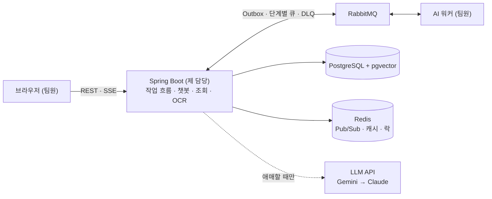
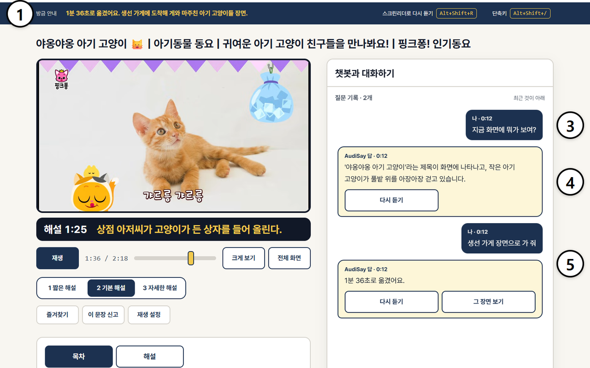
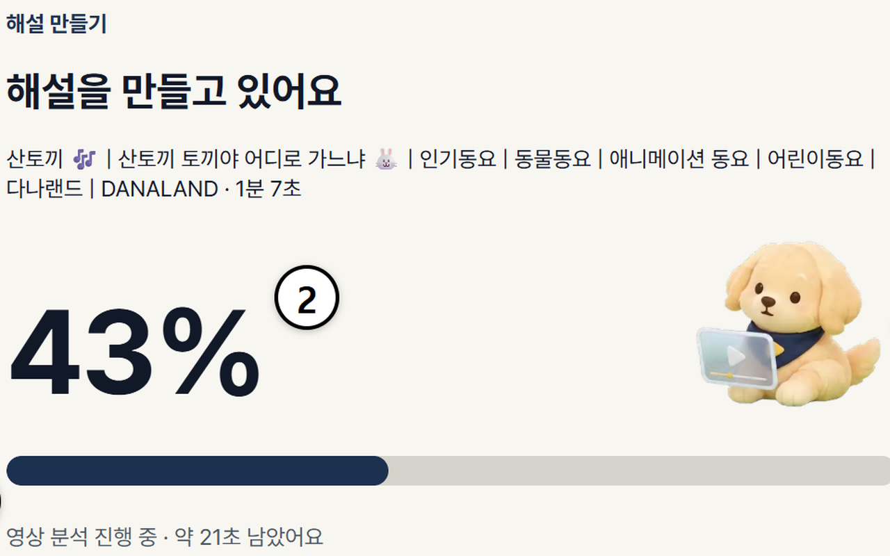
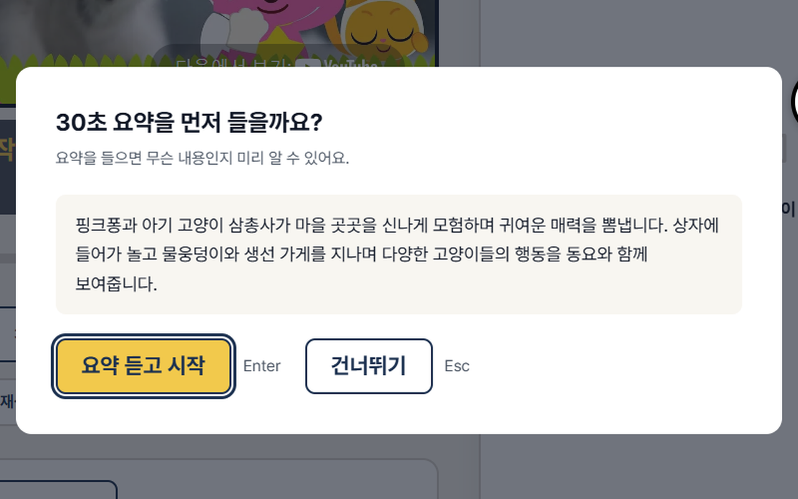
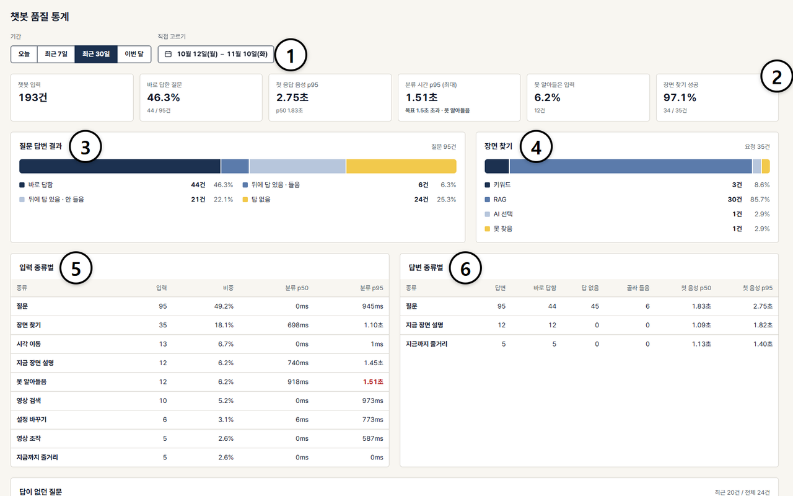

# AudiSay

시각장애인용 AI 화면해설 서비스입니다. 2026년 10월부터 11월까지 약 5주 동안 6명이 만든 SSAFY 자율 프로젝트이고, 저는 Java·Spring 백엔드를 맡았습니다. 코드가 SSAFY GitLab 비공개 저장소에 있어서, 제가 맡은 부분의 구조와 측정 기록을 여기에 옮겨 적습니다.

시각장애인이 영상 해설을 듣기만 하지 않고 “방금 누가 골 넣었어?”처럼 직접 묻고 원하는 장면으로 옮겨 가는 서비스입니다. 저는 해설 생성 작업 흐름, 해설 조회, 음성 챗봇(LLM·RAG), 인증 서류 OCR, 사용량 통계를 Spring Boot로 맡았습니다. 해설을 만드는 AI 워커와 GPU 서버, 회원 인증과 업로드, 인프라·CI/CD, 화면은 다른 팀원의 작업입니다. 코드의 상당 부분은 Claude와 함께 썼고, 구조와 대안 선택, 평가 문항, 측정과 검증은 직접 했습니다.

## 화면

화면은 프론트 팀원들이 만들었고, 저는 이 화면들이 부르는 서버를 맡았습니다. 팀 포팅 매뉴얼에 넣은 캡처라 동그라미 번호가 붙어 있습니다.

| 재생 화면과 음성 챗봇 | 해설 생성 중 |
| :---: | :---: |
|  |  |
| “생선 가게 장면으로 가 줘”라고 하면 장면을 찾아 1분 36초로 옮깁니다 | 진행률은 서버가 SSE로 보냅니다 |
| **30초 요약** | **관리자 챗봇 품질 통계** |
|  |  |
| 해설 조회 API 네 개 가운데 하나입니다 | AI 호출 기록으로 집계합니다. 11월 10일 기준 최근 30일, 팀원과 테스트 계정이 쓴 값입니다 |

## 장애를 일부러 만들어 본 기록

해설 하나는 준비 → 조각별 해설 → 합치기 → 음성 단계를 AI 워커와 메시지로 주고받으며 만들어집니다. 장치를 넣을 때마다 옛 방식과 지금 방식을 스위치로 바꿔 같은 장애를 로컬에서 만들어 비교했습니다.

| 문제 | 고른 방법 (버린 것) | 주입한 상황 | 옛 방식 → 지금 |
|---|---|---|---|
| 마지막 조각이 동시에 도착 | 이벤트마다 작업 행 잠금 (잠금 없음) | 리스너 10개, 이벤트 1,000개 동시 | 합치기 누락 30/100 → 0 |
| 브로커 장애 | Outbox: 같은 트랜잭션에 저장, 커밋 후 발행·확인·재발행 (바로 발행) | RabbitMQ 40초 중단, 작업 50개 | 메시지 유실 50/50 → 0 |
| 처리 도중 장애 뒤 재전달 | 처리 기록을 커밋 뒤에 (커밋 전 선점) | 롤백 뒤 같은 메시지 20개 | 멈춘 작업 20/20 → 0 |
| 워커가 멈춤 | 마지막 활동 기준 정리 스케줄러 (알림을 기다림) | 장애 8가지 상태 주입 | 남은 작업 15/24 → 0 |
| 조각 일부 실패 | 성공한 구간까지 공개 (작업 전체 실패) | 조각 실패율 10%, 작업 100개 | 작업 실패 67% → 13% |

잠금이 없으면 합치기가 두 번 될 거라 예상했는데, 실제로는 한 번도 안 된 작업이 나왔습니다. 두 트랜잭션이 서로 커밋 전 상태를 읽고 둘 다 “아직 남은 조각이 있다”고 판단했기 때문입니다. 이 장치를 다 넣고도 작업 하나에 Spring이 쓰는 시간은 약 162ms, 해설 생성 전체의 0.2~0.6%였습니다.

## 음성 챗봇은 평가 문항부터 만들었습니다

말 한 번이 곧 LLM 호출이라 비용과 지연이 사용자 경로에 붙습니다. 문항 192개(의도 112, 장면 찾기 45, 답변 35)를 직접 쓰고 기능 스위치 9개를 하나씩 켜고 끄며 쟀습니다. 규칙이 먼저 처리하고 애매한 말만 LLM에 보내 의도 분류 정확도를 95.5%에서 99.1%로, 분류 비용은 77% 줄였습니다. 장면 찾기는 대사·해설 한 줄 단위로 키워드와 벡터 검색을 합치고(RRF) 키워드가 확실하면 LLM을 건너뛰게 해, 98문항(개발 45 + 확인 53)에서 정답 80% → 87%, LLM 비용 −58%가 됐습니다. 답변은 질문한 시각까지의 해설만 자료로 써서 뒤 내용이 새지 않게 했습니다.

## 해설 조회가 느렸던 원인

N+1 쿼리를 의심했지만, 음성 주소 서명을 끈 채 다시 재 보니 바로 빨라졌습니다. 음성 파일별 서명 주소만 캐시하고 JSON을 gzip으로 압축해 동시 30에서 p95 562ms → 61ms, 응답 66.9KB → 10.8KB가 됐습니다.

## 인증 서류 OCR을 서버 안에서 돌린 이유

시각장애인 인증 서류에는 주민번호가 있어서, 외부 AI 대신 PaddleOCR 모델(ONNX)을 Spring 안에서 돌렸습니다. 견본 24장을 모두 맞게 판정했고 한 장 처리는 0.96초입니다. 제 코드를 다시 점검하다 작은 PNG 한 장으로 서버 메모리가 바닥나는 구멍과, OCR이 오래 걸리면 확인 없이 승인되던 구멍을 찾아 막았습니다.

## 한계

- 측정은 로컬 PC와 직접 만든 문항 기준입니다. 문항을 직접 만든 만큼 개발용과 확인용을 나눴지만, 실사용자 데이터는 없습니다.
- 팀원이 만든 남은 시간 예측을 단계별로 고쳐 오차 p90을 249%에서 93%로 낮췄지만, 작업 9개 표본이고 첫 예상은 나아지지 않았습니다.
- 해설 조회의 다음 병목은 DB 연결 풀로 옮겨 갔고, 이번에는 손대지 않았습니다.

## 숫자를 잰 방법

| 숫자 | 무엇 | 어떻게 쟀나 |
|---|---|---|
| 유실 50/50 → 0 | 해설 생성 작업 메시지 | 로컬에서 RabbitMQ를 40초 멈춘 채 작업 50개 생성. Outbox를 끈 옛 방식과 비교 |
| p95 562ms → 61ms | 해설 조회 (동시 30) | 로컬, 같은 요청 100회. 음성 주소 서명을 끈 대조 측정으로 원인 확인 |
| 95.5% → 99.1% | 챗봇 의도 분류 | 직접 만든 평가 문항 112개로 바꾸기 전과 뒤를 측정 |

[프로필로 돌아가기](README.md)
